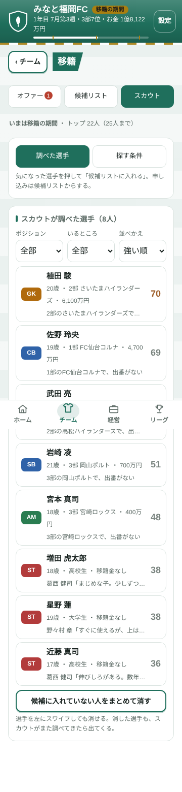
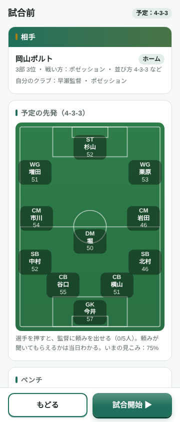
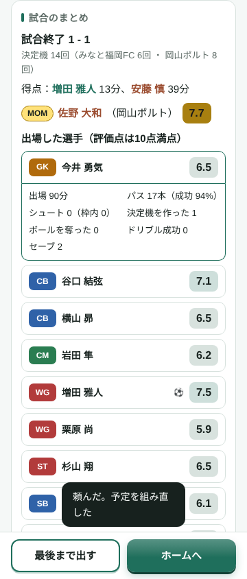
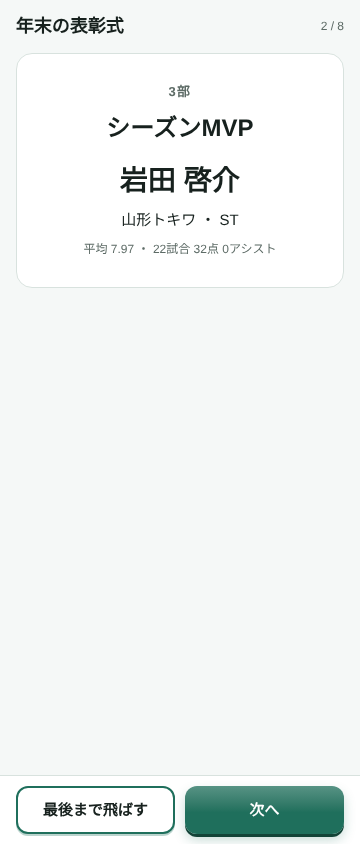
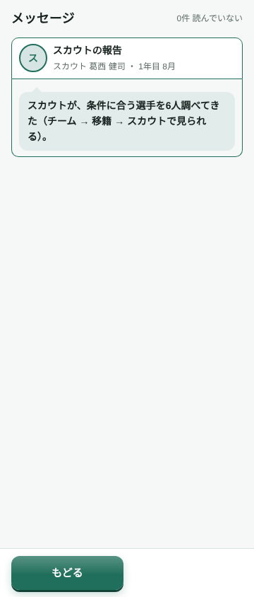
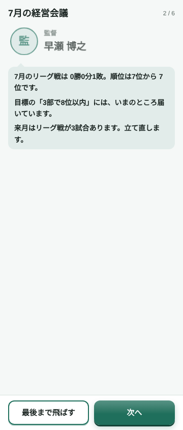
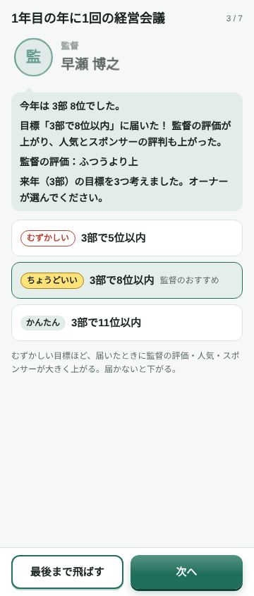
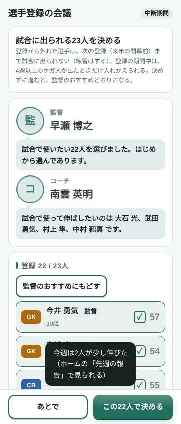
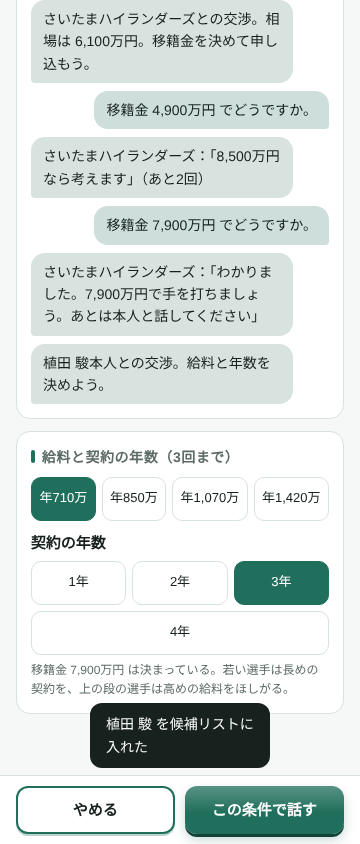
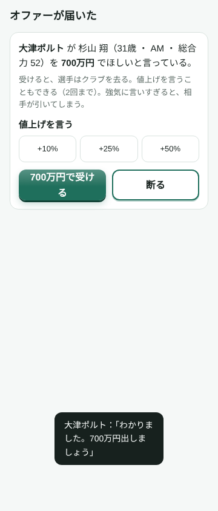

# アップデート3の報告書（1年間のプレイのあとの直し）

もとにしたもの：1年間のプレイの感想30〜48（docs/feedback.md）と、ヒアリング 問97〜120（docs/new/hearing.md）。
5つの段階に分け、段階ごとに公開しました。いまのセーブは、そのまま続けて遊べます。

## 段階1：小さな直し
- 効果音：押したものの種類で音を変える（進む・決める／切りかえ・一覧／もどる・やめる）（問97）
- 上の帯に「何月の第何週」と、1年の進み具合の棒（開幕・中断・終わりの印）を出した。週が進むと日付がめくれる（問98）
- ホームのお知らせを「タスク」（答えが必要なもの）と「ニュース」（読むだけのもの）の2つの箱に分け、重なりをなくした（問99）
- 試合のある週は、ボタンが「試合へ ▶」になる（感想41）
- スカウトの報告（問100〜104）
  - スカウトが調べた選手だけを出す（対戦で見ただけの選手は出さない）
  - 3行目はスカウトのコメント（長いときは「…」）
  - 消し方は3つ：選手の画面の「リストから消す」・左へスワイプ・「候補に入れていない人をまとめて消す」（2回押す）
  - 条件に「クラブに合わせる」（オン：払える額・段の差1つまで）を足した
- お気に入り（☆）：トップとユースにつけられる。並べかえで上に来て、クラブを去ったらリーグの歴史に残る（問103）
- ゲームを始めたときは、どのクラブの選手も総合力80まで（問105）
- 練習生のしくみをなくし、売り込みに来た子はスカウトの報告に届くようにした。預かっていた練習生には帰ってもらった。移籍の画面はオファー・候補リスト・スカウトの3つ（問119）
- 試合のまとめなどの画面が、時計・電池の帯の下にもぐらないようにした

## 段階2：試合
- 試合は、90分を1分ずつ進めるしくみに作り直した（問107）
  - 毎分、ボールを持つ選手・パス・奪う・ドリブル・シュートを決める。決定機は、この流れの先に生まれる
  - 点の入り方・強さの差の出方は、前と同じになるように合わせた
- 選手ごとに数字を数える（パスの数と成功率・シュート・枠内・決定機を作った数・奪った数・ドリブル・セーブ）。その数字から、10点満点・0.1きざみの評価点を出す（問106）
- 試合のまとめ（問108）
  - 一覧には評価点・ゴール・アシストを出し、MOMには金色の札をつけた
  - 選手を押すと、その試合のくわしい数字が開く
  - 監督の信頼は、評価点で動く
- 試合前の画面（問109）
  - 「試合へ ▶」を押すと開く。予定の並び方・ピッチの図の先発・ベンチ・相手が見られる
  - 選手を押すと、その場で監督に頼みを出せる（頼むと、予定がすぐ組み直される）
- 年末の表彰式：自動で開き、1つずつ発表する（問110・111）
  - 自分の段：シーズンMVP・得点王・アシスト王・ベストヤングプレイヤー賞（21歳以下）・ベストイレブン
  - ほかの段：MVPと得点王だけ
  - 自分の選手がとると紙ふぶきが出て、人気・その選手の値段・愛着が上がる

  

## 段階3：メッセージと経営会議
- メッセージ（問112）
  - 上の帯の封筒ボタンから開く（読んでいない数つき）。ホームのタスクにも件数を出す
  - 送ってくる人：選手（「移籍したい」：その場で答えられる）・監督（3連敗・解任の話）・コーチ（覚醒・4週以上のケガ）・スカウト（月の報告・売り込み）
- 月の経営会議：3〜11月の月の終わりに自動で開く（問113・114）
  - 報告する人：経理（収支）・監督（成績・頼みの結果・目標まで）・コーチ（伸び・ケガ）・ユースコーチ（ユースの報告をここにまとめた）・スカウト（おすすめ）
- 年に1回の経営会議：12月、表彰式のあとに開く（問115・116・120）
  - ふり返りと営業の報告
  - 監督が出す来年の目標3つ（むずかしい／ちょうどいい／かんたん）から選ぶ
  - いまの不足と強化方針、補強の予算
  - コーチの伸びしろの見立て：下がった人が先で、矢印と理由つき。選手の画面にも毎年残る
- 目標の結果（問115）
  - 届いたか届かなかったかで、監督の評価・人気・来年のスポンサーが上下する
  - 評価がとても低いと、監督から「代えてもいい」と話が出る

  

## 段階4：選手登録・中断期間・交渉
- 選手登録（感想42・問117）
  - トップは35人まで。試合に出られるのは、登録した23人だけ
  - 選手登録の会議は、開幕前（2月第4週）と夏の中断期間の最後（8月第1週）に開く。監督・コーチ・スカウトがおすすめを言う
  - 4週以上のケガのときだけ、登録を入れかえられる
- 夏の中断期間：7月第3週〜8月第1週の3週は、リーグ戦が休み（問117）
- 移籍の交渉（問118・問52を変更）
  - 獲るとき：相手のクラブと移籍金、本人と給料と年数を、それぞれ3往復まで話す
  - まとまらないと、同じ移籍の期間はその選手に申し込めない
  - 売るとき：オファーに値上げ（+10%・+25%・+50%）を言える。強気すぎると、相手が取り下げる
  - 年の会議で決めた補強の予算はこえられない

  

## 段階5：10シーズンの確かめ
`scripts/balance.ts` を3つのクラブで10シーズンずつ動かし（オーナーは「おまかせ」）、`scripts/season10.ts` で目標・会議・登録を確かめた。

| 項目 | 前（夜2のあと） | いま | 目安 |
|---|---|---|---|
| 1試合の得点 | 2.34 | 2.26 | 2.0〜3.0 |
| 強いほうの勝ち率（力の差3〜6） | 62.7% | 60.9% | 6〜7割 |
| 先発の総合力（1部・2部・3部） | 73.9・67.0・55.7 | 74.0・67.2・55.7 | 72〜75・65〜70・50〜60 |
| 1部でいちばん強い選手 | 82.4 | 81.6 | 82〜85（育ったあと） |

- 試合の数字（1シーズンの平均）
  - 1チームのパス 260本ほどで、成功率は83〜85%。シュート 8〜9本
  - 評価点：平均6.4・中央6.3。下から1割が5.7、上から1割が7.3
- 目標の「ちょうどいい」は、はじめ8割が届いてしまっていた。そこで、12月に来年の目標を出すときは冬の伸びのぶん少し上を見るようにし、届くのが5割ほどになるよう合わせた
- 2部・1部の「残る（10位以内）」の目標が、11位以内の目標と取りちがえられることがあったので直した
- 月の経営会議は1年に9回、年の会議は1回開く。登録していない選手は試合に出ていない
- コーチの昇格のおすすめは30人までにとどめた（トップは35人まで持てるが、給料がふくらみすぎないように）

## 気づいたこと・次に相談したいこと
- 「おまかせ」で遊ぶと、2部に上がってすぐ12位で落ちるくり返しが見られる。2部の壁を高いと感じるかを、遊んで確かめてほしい
- 1シーズンで40点・20アシストをこえる選手が、ときどき出る（下の段に、とても強い選手が1人いるとき）。多すぎると感じたら直す
- 交渉で相手が言った額は、少し下げても受けてもらえることがある（相手の言い値は、売ってもいい最低の額より少し上）。値切る楽しみとして残したが、ゆるすぎたら直す
- 今のシーズンの途中で入った選手は、登録に空きがあれば、そのまま登録される。空きがなければ次の登録の会議まで待つ
